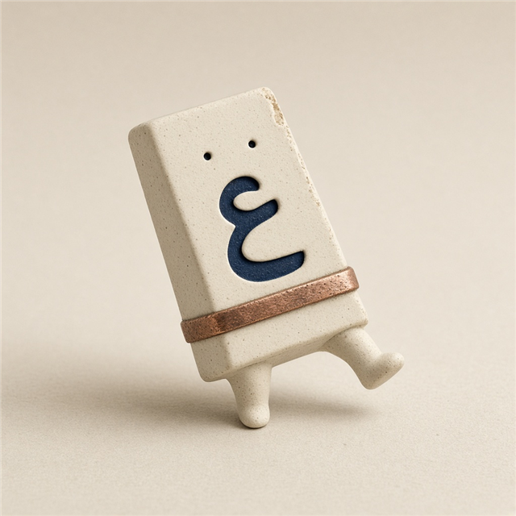

# فلتة

الحروف فلتت لأن اللغة كانت غلط؟ فلتة ترجّع كل حرف لمفتاحه على لوحة المفاتيح. مش ترجمة. النص ما يطلعش من جهازك.

أداة ليك ولصحابك. مش على متجر، ومش تابعة لإضافة تانية.



## مثال

`;dt phg;` تقلب إلى **كيف حالك**. الكاف هو المفتاح `;`، عشان كده العلامة دي جزء من الجملة. `dt phg;` لوحدها تبقى «يف حالك».

## التثبيت

نفس مجلد `extension` على ويندوز ولينكس والماك.

1. نزّل الريبو أو اعمل clone.
2. افتح صفحة الإضافات في المتصفح.
3. فعّل وضع المطوّر.
4. اختار المجلد `extension` (مش جذر المشروع).

| المتصفح | الصفحة | الملاحظة |
| --- | --- | --- |
| كروم | `chrome://extensions` | Load unpacked. تفضل بعد إعادة التشغيل. |
| إيدج | `edge://extensions` | Load unpacked. |
| بريف | `brave://extensions` | Load unpacked. |
| أوبرا | `opera://extensions` | Load unpacked. |
| فيفالدي | `vivaldi://extensions` | Load unpacked. |
| فايرفوكس | `about:debugging#/runtime/this-firefox` | This Firefox ثم Load Temporary Add-on واختار `manifest.json`. بتتشال لما فايرفوكس يقفل. |
| سفاري | — | المجلد مش بيتركّب من غير أدوات أبل. استخدم الصفحة أو زر الإشارة. |

ويندوز ولينكس والماك: الخطوات واحدة. اختصار ويندوز/لينكس `Ctrl+Shift+X`. على الماك `Command+Shift+X`. تقدر تغيّر اختصار الصفحة من إعدادات فلتة، واختصار أمر المتصفح من صفحة اختصارات الإضافات.

### من غير إضافة

افتح `web/index.html` في أي متصفح، حتى سفاري. بعد `node scripts/build.mjs` يقدر أصحابك يسحبوا زر «اسحبني لشريط الإشارات».

من الطرفية، على أي نظام فيه Node 18 أو أحدث:

```bash
node cli/falta.mjs ";dt phg;"
node cli/falta.mjs --layout mac z
node cli/falta.mjs --split "لا"
```

## الاستخدام

- علّم النص في أي صفحة واضغط الاختصار، أو كليك يمين «اقلب التخطيط»، أو الزر الصغير جنب التحديد.
- من أيقونة فلتة: الصق، اقلب، انسخ. لو في تحديد في الصفحة، النافذة تجيبه.
- لو «لا» ليها قراءتين، زر البديل يبدّل بين مفتاح `b` ومفتاحين `gh` من غير نافذة توقفك.
- لوحة **عربي ١٠١** هي الافتراضي (ويندوز، لينكس، وماك Arabic-PC). **عربي الماك** للتخطيط الأصلي، والصف السفلي فيه مختلف.
- الزر العائم يتقفل من الإعدادات.
- السمة الغامقة من الزر، أو من إعدادات الإضافة: زي الجهاز / فاتح / غامق.

## الخصوصية

التحويل على الجهاز. الإضافة مالهاش صلاحية شبكة، ومش بتبعت النص. العداد المحلي بيعدّ المرات بس، ومش بيحفظ الكلام. عشان الزر العائم يشتغل في المواقع، سكربت المحتوى بيتسجّل على الصفحات؛ هو بيقرأ التحديد لما تطلب القلب.

بعض الصفحات، زي مستندات جوجل، بتمنع تعديل التحديد. فلتة تنسخ النتيجة وتقول كده، بدل ما تسكت.

## التطوير

```bash
npm test
node scripts/build.mjs
```

الاختبارات تغطي الجملة، الحروف الكبيرة، أشكال الألف، لا وبديلها، الأرقام، والفرق بين z على ويندوز والماك. تباين الألوان متثبت في `tests/contrast.test.js`. قرارات الواجهة في `docs/design.md`.

الخطوط في `web/fonts` و`extension/fonts` تحت رخصة OFL. شوف `web/fonts/OFL.txt`.

## الرخصة

MIT. شوف `LICENSE`.
